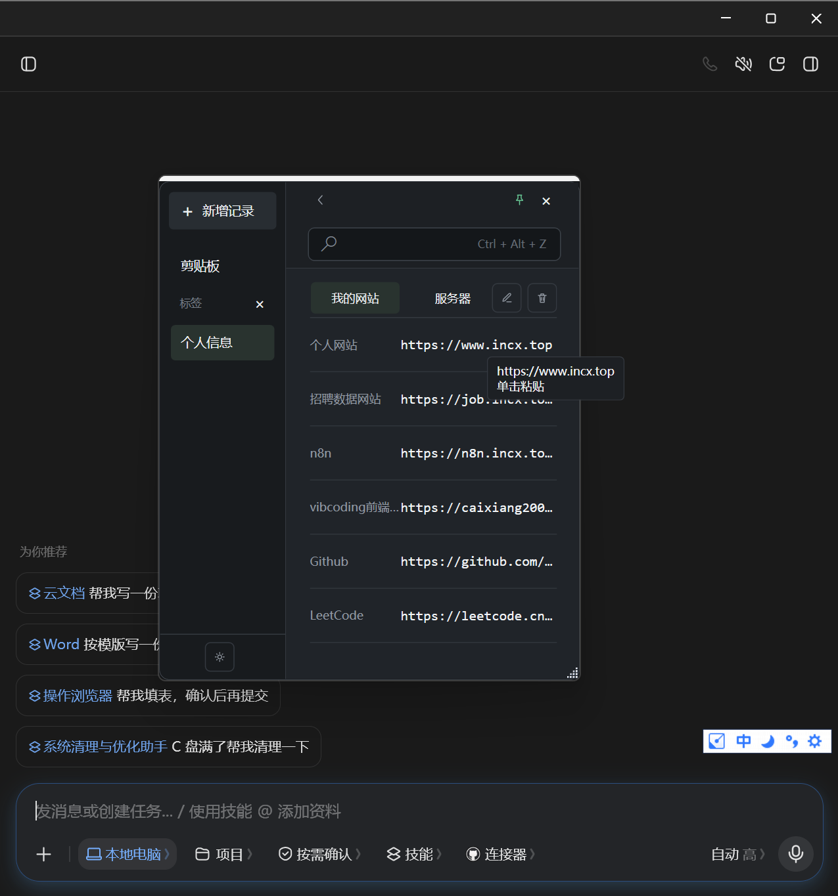
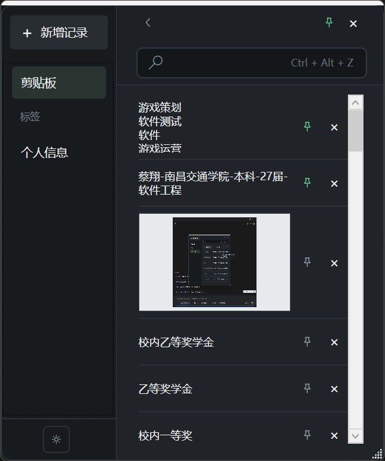

# QuickCopy

QuickCopy 是一个 Windows 工作信息快捷存储与粘贴工具。

## 为什么做这个项目

日常工作中经常需要在文档、浏览器、聊天工具和业务系统之间切换，反复查找信息、选中、复制，再切回目标窗口粘贴。账号、服务器地址、Token、命令和备注等内容使用频率高，但普通剪贴板只能保留最近一次复制的内容。

QuickCopy 用来集中保存这些常用信息，同时记录最近的文本和图片剪贴板历史。通过 `Ctrl + Alt + Z` 呼出工具，点击对应内容后即可自动粘贴回原来的输入位置，减少重复的窗口切换和复制粘贴操作。

## 功能展示

**点击即粘贴**：通过 `Ctrl + Alt + Z` 呼出窗口，窗口会自动定位在光标附近；鼠标悬停条目显示"单击粘贴"，点击即可将网址、命令等内容一键填写到当前光标处，无需来回切换窗口：



**剪贴板历史与置顶**：自动记录最近的文本和图片剪贴板历史（上限 50 条），支持置顶常用内容、单条删除与搜索过滤：



**常用信息集中保存**：按标签分类集中保存账号、密码、服务器地址、Token、网址等日常高频使用的信息，点击即粘贴；密码字段自动打码显示，数据保存在本机 `%LOCALAPPDATA%\QuickCopy`。

## 生成 exe

项目使用 Windows WPF 和 .NET Framework 4.0，不依赖第三方库，目标平台为 x64。

在 PowerShell 中执行：

```powershell
powershell -ExecutionPolicy Bypass -File .\build.ps1
```

生成的程序位于：

```text
bin\Release\QuickCopy.exe
```

也可以直接运行项目根目录中的 `QuickCopy.exe`。

程序数据保存在 `%LOCALAPPDATA%\QuickCopy`。当前没有数据加密功能，请不要在不可信设备上保存敏感信息。
